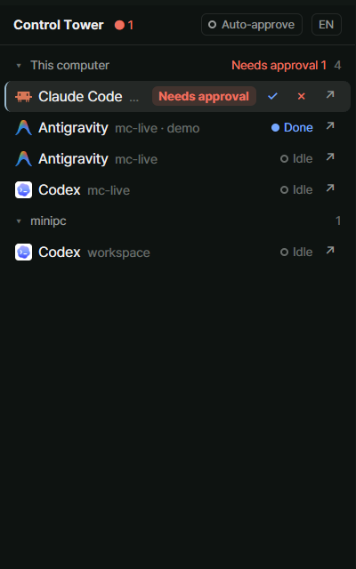

# Control Tower — a Herdr mod

A right-hand panel for [Herdr](https://herdr.dev): every coding agent on every machine as a one-line tree, with approve / deny buttons, a one-line prompt box, and an opt-in auto-approve that holds anything dangerous. Eight languages (English, 한국어, 日本語, 简体中文, Español, Deutsch, Français, Português): it starts in your system's language when it has it, English otherwise, and one button steps through them.

여러 AI 코딩 에이전트(Claude Code, Codex 등)를 한 패널에서 관제하는 Herdr mod. 상태 트리, 승인·거절 버튼, 한 줄 프롬프트 전송, 위험 명령을 걸러내는 자동승인(기본 꺼짐). 8개 언어, 시스템 언어를 따르고 버튼으로 전환.



## Why this one

- **One glance, every agent.** Claude Code, Codex and friends on every machine, as a one-line tree, most urgent first. Sub-agents nest under their parent.
- **Approve without leaving your seat.** A waiting dialog gets ✓ / ✗ buttons. Before it sends a key it re-checks that the dialog is still there.
- **Auto-approve that holds the line.** Off by default and never saved. It only approves a dialog it read completely, and holds anything matching a danger rule, plus fetches, tool calls, oversized dialogs and hidden characters. It reads the screen twice, rate-limits to 10 a minute, and warns you when it holds.
- **Talk to any agent.** A one-line prompt box sends to the chosen agent, and refuses while that agent waits on a dialog so it can't answer it by accident.
- **Multi-machine.** Remote machines get their own groups, with connecting / disconnected states.
- **Eight languages.** English, 한국어, 日本語, 简体中文, Español, Deutsch, Français, Português. Follows your system language, one button to switch.
- **Tested.** Unit tests for the tree, the danger rules, the dialog reader and auto-approve, plus real Claude Code screen fixtures.

## Requirements

- Herdr with **herdr-core 0.1.21 or newer** (older cores don't report Claude Code's status).
- Windows, Linux or macOS. Agents on other machines show up once the machine is added in Herdr.

## Install

1. Copy `mods/control-tower/` into `~/.config/herdr-app/mods/`.
2. Put it in a layout of your own (shipped layouts are read-only):

   ```sh
   herdr-app do layout.clone '{"name":"main","as":"tower"}'
   ```

   Then in `~/.config/herdr-app/layouts/tower.json`, add this as the last child of `work-body`:

   ```json
   { "id": "control-tower", "type": "block", "size": { "px": 320 }, "min": 240, "max": 560, "content": { "mod": "control-tower" } }
   ```

3. `ctrl-shift-l` switches between layouts.

Or point your agent at this repo: `RECIPE.md` is the full brief.

## Before you add it

- It runs `hc keys`, `hc send` and `hc read` on your agent terminals. That is how the buttons and the prompt box work. It makes no network calls and reads or writes no files.
- **Auto-approve is a filter, not a sandbox.** It is off at every start. When on, it approves a dialog only if it read the whole dialog and nothing in it matches a danger rule (`rm -rf`, `sudo`, `git reset --hard`, `git push --force`, `curl | sh`, `Remove-Item -Recurse`, secrets files, and more). It cannot see what a script does: `bash build.sh` or `npm run x` pass. Your agent's own permission settings are the stronger tool.
- Checked against Claude Code 2.1.322. Codex's dialog format is not confirmed yet, and agents without a known format are never auto-approved.

## Develop

```sh
npm test
```

```sh
herdr-app check mods/control-tower
```

The logic (`tree.js`, `control.js`, `detector.js`, `safety.js`, `auto.js`) is plain JavaScript with no Herdr imports, so the tests run under Node without Herdr.
