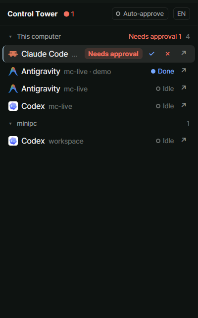

# Mission Control

A right-hand panel that lists every coding agent on every machine as a one-line tree, most urgent first. Each row jumps to its agent; a row waiting on an approval dialog gets approve and deny buttons. A one-line box at the bottom sends a prompt to the chosen agent. An opt-in switch approves dialogs by itself when the whole dialog could be read and nothing in it matches a danger rule. Eight languages (English, 한국어, 日本語, 简体中文, Español, Deutsch, Français, Português): the system's language when there is a table for it, English otherwise, switchable.

## What you see

A column 320px wide (240 to 560), `chrome` background, 1px `border` on its left edge, 13px text. Top to bottom:

- **Top bar**, 36px, 1px `border` below. Left: the title ("관제탑" / "Mission Control"), 12px semibold. Then, only when above zero, "승인대기 N" in `blocked` and "실행 N" in `working`, 11px. Right: the auto-approve switch (a 20px pill: a 7px ring and "자동승인" in `muted` while off; a filled dot, `blocked` text, `blocked` border and a 15% `blocked` fill while on), then the language button (a 20px pill reading the current language's short label: EN, 한, 日, 中, ES, DE, FR, PT).
- **List**, fills the rest and scrolls. One group per machine: this computer first, then machines by name. A group header is 28px: a fold mark (▾ / ▸), the machine's name ("이 컴퓨터" for this one), "연결 중" or "연결 끊김" when its layout is not ready (the latter in `blocked`), the group's waiting count, and its agent count. With one machine only, the header is left out. A machine with no agents shows "에이전트 없음".
- **Agent row**, 28px, 7px corners: the program's icon (15px), its name (up to 96px), "space · tab" in `dim` 11.5px (the tab only if someone named it), the status, then buttons. A 2px left edge in `accent` marks the row the prompt goes to. The focused agent's row has the `selected` background. Rows of a machine that can't be reached are at 55% opacity.
- **Sub-agent row**, 24px, under its parent: tree guides (`├`, `└`, `│`) in `input`, a 13px icon, its name in `muted` 12px, status, buttons.
- **Log line** (only while auto-approve is on, or once it has logged something), 24px, 1px `border` above: "자동승인 N" in `done`, "보류 N" in `blocked`. Click to open the last six entries, 20px each: time, terminal, reason, first line of the command.
- **Prompt bar**, 1px `border` above. If the last action said something, one 11px line: "t3 · 승인 보냄", in `blocked` when it failed. Then: a chip naming the target ("t3 ▸"), a 26px text input, a send button (⏎).

## How it behaves

- **working**: a braille spinner (`.frames`, 90ms) and "실행" in `working`.
- **blocked**: "승인대기" in a pill with a 15% `blocked` fill, then ✓ (approve, `done`) and ✗ (deny, `blocked`).
- **done**: a filled 7px dot and "완료" in `done`.
- **idle**: a 7px ring and "유휴" in `idle`.
- A sub-agent in `error` reads as blocked but gets no approve / deny (it has no dialog). A sub-agent is never shown as done.
- Order inside a machine: blocked, done, working, idle; a parent takes its most urgent sub-agent's place; ties go to the most recently changed.
- **Click a row**: makes it the prompt's target and focuses its pane. Clicking a sub-agent only makes it the target.
- **↗**: focuses the agent's pane (`pane.focus`); on a sub-agent, peeks at it (`terminal.peek`).
- **✓ / ✗**: first checks that the terminal still waits on a dialog; if not, sends nothing and says so. ✓ presses Enter, ✗ presses Esc. One action per terminal at a time.
- **Prompt**: Enter or ⏎ sends the line to the target with `hc send`. Line breaks and tabs become spaces; control characters are dropped. Not sent while the target waits on a dialog (it would answer the dialog).
- **Language button**: steps to the next language in the list and back to the first; every string switches, and what was typed carries over. Its tooltip names the current and the next language. Saved in `shared("mission-control.lang")`. Until picked, the language follows the system locale (`Intl`): the locale's first part (`pt` of `pt-BR`) when there is a table for it, English otherwise. Key names (Enter, Esc) and the dialog's own "Yes" are never translated.
- **Group header**: click folds the group.
- **Auto-approve switch**: off at every start, never saved. While on, every 2 seconds it looks at each waiting agent on reachable machines:
  1. reads the terminal's screen;
  2. reads the dialog off it (header, question, answers, cursor on "1. Yes", not cut short);
  3. judges it; anything not fully read, a fetch or tool call, over 4000 characters or 80 lines, invisible characters, or a danger rule match is held;
  4. reads the screen again and holds unless the same dialog is still there;
  5. holds unless the agent still waits and the switch is still on;
  6. presses Enter.
  At most 10 approvals a minute. A dialog still there after its Enter is not pressed twice. A held dialog is looked at again every 10 seconds. A hold caused by a danger rule posts one warning toast that focuses the agent when clicked.

## Built from

- A mod only: `mods/mission-control/`. No layout of its own. `mod.json`: `{ "place": "right", "size": 320, "title": "Mission Control", "overlay": { "width": 380, "height": 560 } }`.
- `main.js`: the `View`. State, the 2s timer (`cx.timer.every`), wiring.
- `tree.js`: pure. `buildGroups(agents(), terminals(), machines())` groups by machine (the `machine/` prefix of an address), builds the sub-agent tree from `parent`, sorts by urgency.
- `control.js`: pure. Builds `hc` argument lists (`keys -- <t> enter|esc`, `send -- <t> <text>`, `read -- <t>`), cleans a prompt, reads `hc`'s result (its JSON `{"error":{"message"}}` counts as failure).
- `detector.js`: pure. `parseDialog(app, screen)` reads an approval dialog; specs per `AgentInfo.app` (`claude-code`, `codex`).
- `safety.js`: pure. `judge(dialog)` gives approve or hold with a reason; 56 rules over deleting, elevation, git history, disks, permissions, power and services, indirect execution, publishing and infrastructure, Windows registry and accounts, and sensitive paths. Each command is tried as shown, with wrapped lines joined, and with quotes, backslashes and carets removed.
- `auto.js`: pure. `attempt()` (the six steps above), `RateLimit`, `Tracker`.
- `ui.js`: every element. `strings.js`: pure; one table of 51 strings per language, the language list (`LANGS`), `pickLang(locale)`, `nextLang(id)`. `i18n.js`: which language is shown (`shared`).
- `herdr` functions: `agents`, `terminals`, `machines`, `spaces`, `theme`, `run`, `hc`, `notify`, `shared`, `setShared`. Commands: `pane.focus {pane}`, `terminal.peek {terminal}`.
- Programs it runs: `hc` only, through `hc()`. No `exec`, no `fetch`, no files read or written.
- Art: none of its own; program icons come from `AgentInfo.program`.
- Tests (plain node, outside the mod folder): `npm test`, 78 tests, with two screens captured from Claude Code 2.1.322.

## Watch out

- **Needs herdr-core 0.1.21 or newer.** On 0.1.16 Claude Code reported no status, so no row appeared; and `hc read --lines N` on a full-screen program never returned.
- **It does not dock itself into a shipped layout.** Clone the layout and add the block: `herdr-app do layout.clone '{"name":"main","as":"mission"}'`, then in `layouts/mission.json` add `{ "id": "mission-control", "type": "block", "size": { "px": 320 }, "min": 240, "max": 560, "content": { "mod": "mission-control" } }` as the last child of `work-body`.
- **It presses keys in your terminals.** Tell the person before adding it: it runs `hc keys`, `hc send` and `hc read` on every agent terminal, on other machines too.
- **Auto-approve is a filter, not a sandbox.** It can't see what a script does (`bash build.sh`, `npm run x`, `node script.js` all pass), nor anything the dialog did not show. Leave it off unless that is acceptable; the agent's own permission settings are the stronger tool.
- **It holds harmless things too**: `cat .env`, `git branch -d`, `git add dd`. That is on purpose.
- Use `--` before the address in every `hc` call, or a prompt like `--force` is read as a flag.
- Pass `hc read` no `--lines`: the dialog is on the screen, and a dialog too tall for the screen has no header in view and is held.
- When several headers are in view, read from the topmost one: a command can print a fake "Bash command" block to hide what stands above it. If the headers are of different kinds, hold.
- Strip only box-drawing characters from line edges, never ASCII `|` or `-`: a pipe at the end of a wrapped line is part of the command.
- A rule written `rm\s+…\s-rf` never matches `rm -rf` (the one space is used up); use a lookahead after the command word.
- The folder-trust dialog's default is "No, exit"; it has no "1. Yes" and must stay unanswered.
- A placeholder is fixed when an `InputState` is made, and `InputState.new` can't run during render: make one input per language in `init()`.
- The translations other than English and Korean were not checked by native speakers.
- `herdr-app shot` returns the last drawn frame; with the window behind others it can be minutes old.
- **Not checked yet**: Codex's dialog (written from memory), agy (no spec, always held), agents on another machine.
- Codex and other agents answer with Enter / Esc by default; set their keys in `control.js` once confirmed.

## Done when

- `herdr-app check mods/mission-control` passes and `npm test` reports 78 passing.
- With Claude Code running in a tab, its row shows with the right status as it works, waits and finishes.
- On a waiting row, ✓ closes the dialog and the command runs; ✗ closes it and nothing runs.
- A line typed in the prompt bar arrives in the target agent; while it waits on a dialog the line is refused with a message.
- The language button steps through all eight languages, switching every string each time, and the choice survives a restart.
- With auto-approve on: `mkdir x` is approved without a click and logged; `rm -rf x` stays waiting, is logged as held by `rm-flags`, and a toast says so.
- Turning auto-approve off stops it at once; after a restart it is off.
